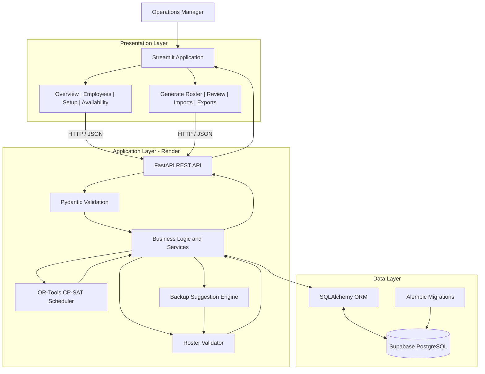
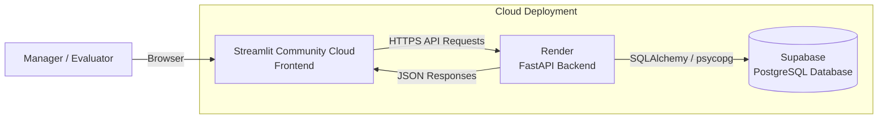
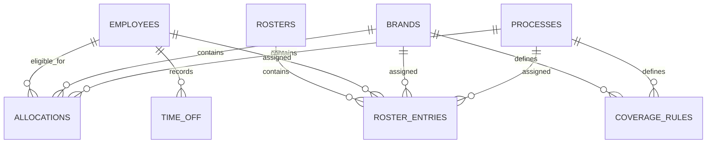
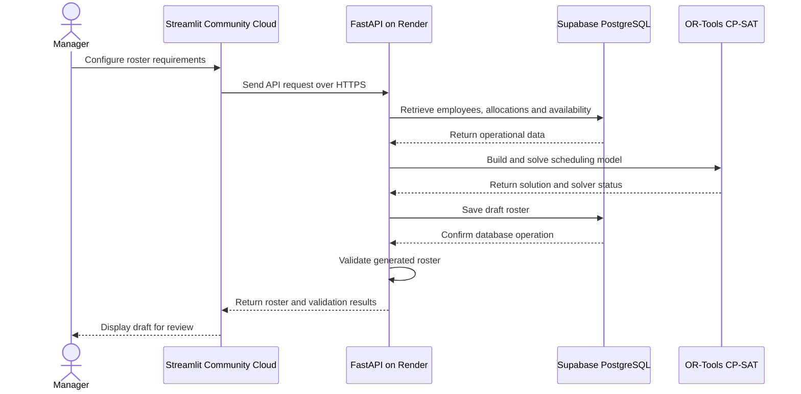

# Smart Roster Management System

**A constraint-based workforce scheduling and roster management application developed for the DataStraw Tech Internship Assessment.**

The Smart Roster Management System helps operations managers manage employees, brands, processes, allocations, availability, and staffing requirements. It generates draft rosters using constraint-based optimization, validates assignments against operational rules, and provides tools for reviewing, editing, and publishing schedules.

The application uses **Python, Streamlit, FastAPI, Supabase PostgreSQL, and Google OR-Tools CP-SAT**.

---

## 1. Project Overview

Operations teams supporting multiple direct-to-consumer (D2C) brands need to coordinate employee availability, process allocations, weekly offs, holidays, leave, and minimum staffing requirements.

Managing these requirements manually can result in:

- Insufficient staffing for a brand or process.
- Employees being assigned to multiple processes on the same day.
- Assignments that conflict with leave or holidays.
- Employees exceeding their permitted work limits.
- Coverage gaps after roster changes.
- Difficulty maintaining and reviewing schedules across multiple brands.

This application addresses these problems through a centralized roster management interface and a constraint-based scheduling engine.

The manager can configure the workforce, generate a draft roster, inspect validation results, consider backup suggestions, make manual changes, and publish a validated roster.

## 2. Key Features

### Employee Management
- Create, view, update, deactivate, and reactivate employees.
- Maintain employee IDs, names, email addresses, titles, and pod labels.
- Configure maximum consecutive working days.
- Configure maximum weekly working days and minimum weekly offs.
- Import employee records using CSV and XLSX files.

### Brand and Process Management
- Create and manage multiple brands.
- Create and manage operational processes.
- Associate employees with multiple brand-process combinations.

### Resource Allocation
- Allocate employees as `PRIMARY` or `BACKUP`.
- Maintain multiple eligible employees for each brand-process combination.
- Prevent duplicate allocations.
- Review allocation counts and staffing structure.

### Coverage Configuration
- Configure minimum primary staffing for each brand-process combination.
- Configure operating calendars:
  - `DAILY`
  - `MON_SAT`
  - `CUSTOM`
- Support custom weekday configurations using Monday = 0 through Sunday = 6.

### Availability Management
- Record employee leave.
- Record compensatory offs.
- Record employee-specific holidays.
- Maintain company-wide holidays.
- Configure whether a company holiday represents a full closure.

### Constraint-Based Roster Generation
- Generate a draft for a selected inclusive date range.
- Use Google OR-Tools CP-SAT to solve employee assignment constraints.
- Enforce staffing, availability, and employee work-limit rules.
- Balance employee workload.
- Preserve locked entries during draft regeneration.

### Roster Validation
- Identify minimum staffing gaps.
- Detect duplicate assignments and employee double-booking.
- Check employee eligibility and active status.
- Detect leave and holiday conflicts.
- Validate consecutive workday limits.
- Validate weekly working-day limits and minimum weekly offs.

### Backup Suggestions
- Identify eligible backup employees for coverage gaps.
- Check employee availability and workload constraints.
- Simulate proposed replacements.
- Allow managers to accept suitable suggestions after validation.

### Manual Roster Management
- Edit draft assignments.
- Lock and unlock roster entries.
- Regenerate unpublished rosters while preserving locked entries.
- Validate changes before publishing.

### Roster Views and Exports
- View the complete roster.
- Filter or group schedules by:
  - Brand
  - Process
  - Pod
  - Employee
- Export roster data to CSV and XLSX.

### Draft and Publishing Workflow
- Maintain draft and published roster states.
- Require successful validation before publishing.
- Prevent editing or regenerating published rosters.

---

## 3. Technology Stack

| Technology | Purpose |
|---|---|
| Python 3.12 | Primary programming language |
| Streamlit | Browser-based management interface |
| FastAPI | Backend REST API |
| Pydantic | Request validation and data schemas |
| SQLAlchemy | ORM and database access |
| Alembic | Database schema migrations |
| PostgreSQL | Relational database |
| Supabase | Hosted PostgreSQL database |
| Google OR-Tools CP-SAT | Constraint-based roster optimization |
| Pandas | Data processing and tabular operations |
| openpyxl | Excel import and export |
| Requests | Frontend-to-backend HTTP communication |
| python-dotenv | Environment variable management |
| Uvicorn | FastAPI application server |
| pytest | Automated testing |
| Render | Backend hosting |
| Streamlit Community Cloud | Frontend hosting |
| Git and GitHub | Version control and source code management |

### Why OR-Tools CP-SAT?

Roster generation is a constraint satisfaction and optimization problem.

For every eligible employee, brand, process, and date, the scheduler considers whether an assignment should be made.

CP-SAT allows the application to represent operational requirements as explicit mathematical constraints rather than relying on random assignment or an opaque prediction model.

This makes the scheduling process easier to inspect, validate, and extend.

---

## 4. System Architecture

The application follows a three-layer architecture.

1. **Presentation layer:** Streamlit provides the browser-based interface used by the operations manager.
2. **Application layer:** FastAPI handles requests, business logic, validation, imports, exports, and roster operations.
3. **Data and optimization layer:** Supabase PostgreSQL stores application data, while OR-Tools CP-SAT generates optimized roster assignments.

### Architecture Diagram



### Deployment Architecture



### Request Flow

1. The manager interacts with the Streamlit interface.
2. Streamlit sends an HTTP request to the FastAPI backend.
3. FastAPI validates the request and executes the appropriate service operation.
4. SQLAlchemy reads or updates the Supabase PostgreSQL database.
5. For roster generation, the backend retrieves relevant workforce data and constructs the CP-SAT optimization model.
6. The scheduler returns assignments or a solver status.
7. The backend validates the resulting roster.
8. The response is returned to Streamlit for display.

The frontend and backend are deployed separately. The Streamlit application communicates with the Render backend using its configured API URL.

---

## 5. Database Design

The application uses a relational database.

### Main Tables

| Table | Responsibility |
|---|---|
| `employees` | Employee identity, title, pod, active status, and work limits |
| `brands` | Brand records |
| `processes` | Process records |
| `allocations` | Employee eligibility and primary/backup roles |
| `coverage_rules` | Minimum staffing and operating calendars |
| `time_off` | Employee leave, comp-offs, and holidays |
| `company_holidays` | Company-wide holiday records |
| `rosters` | Roster date range, status, version, and timestamps |
| `roster_entries` | Individual employee assignments |
| `import_logs` | Import results and row-level error details |

### Entity Relationship Diagram



### Important Relationships

- An employee can have multiple allocation records.
- Each allocation connects one employee to a brand-process combination.
- An allocation identifies whether the employee is a primary or backup resource.
- Each coverage rule belongs to one brand-process combination.
- A roster contains multiple daily roster entries.
- Each roster entry identifies an employee, brand, process, date, and assignment status.

**Pod modelling:** The current implementation stores the pod as an employee-level text attribute. It supports pod-based roster grouping, but does not have a separate pod table or pod-lead management relationship.

---

## 6. Scheduling Algorithm

The roster generator uses Google OR-Tools CP-SAT.

### 6.1 Input Data

For a selected date range, the scheduler considers:

- Active employees.
- Employee maximum consecutive working days.
- Employee maximum weekly working days.
- Minimum weekly offs.
- Primary and backup allocations.
- Brand-process coverage requirements.
- Operating weekdays.
- Employee leave and comp-offs.
- Company-wide holidays.
- Existing locked entries when regenerating a draft.

The date range is inclusive.

### 6.2 Decision Variables

The scheduler creates Boolean assignment variables for eligible employee-brand-process-date combinations.

A value of:

- `1` means the employee is assigned.
- `0` means the employee is not assigned.

It also tracks whether an employee works on a particular date.

Normal solver assignments use primary allocations. Backup resources are handled through the separate backup-suggestion workflow.

### 6.3 Hard Constraints

The scheduling model enforces the following rules:

**1. Employee eligibility**

An employee can only be assigned to a brand-process combination for which they have an eligible primary allocation.

**2. Minimum staffing**

Every configured brand-process combination must meet its minimum primary staffing requirement on operating days in strict generation mode.

**3. No double-booking**

An employee cannot be assigned to multiple processes on the same date.

**4. Employee availability**

Employees cannot be assigned on their recorded leave or comp-off dates.

**5. Company closures**

A full-closure company holiday prevents assignments on that date.

**6. Maximum consecutive workdays**

The model limits assignments within sliding windows according to each employee's maximum consecutive workday setting.

**7. Weekly work limits**

The model enforces maximum working days within Monday-to-Sunday weeks.

**8. Minimum weekly offs**

The model ensures the configured minimum weekly offs, including the implementation's handling of partial weeks at roster boundaries.

**9. Locked assignments**

Locked assignments must be retained when regenerating an existing draft. An incompatible locked assignment can make the model infeasible.

### 6.4 Objective Function

The scheduler uses a weighted objective to:

1. Minimize coverage gaps when incomplete generation is enabled.
2. Reduce differences between employee assignment loads.
3. Minimize unnecessary assignments.

This helps produce a roster that satisfies the configured rules while distributing work more evenly.

### 6.5 Solver Outcomes

The scheduler reports the CP-SAT result status:

| Status | Meaning |
|---|---|
| `OPTIMAL` | A feasible optimal solution was found |
| `FEASIBLE` | A feasible solution was found |
| `INFEASIBLE` | No feasible solution exists for the model |
| `UNKNOWN` | The solver could not establish a result within its available search |

With strict generation enabled, an infeasible result does not create a roster.

Incomplete generation can produce a draft with explicit coverage gaps. Such a draft still requires correction and cannot be published while validation errors remain.

---

## 7. Backup Suggestion Workflow

Backup allocations are stored separately from primary allocations.

When a coverage gap is identified, the backup module:

1. Identifies backup employees eligible for the affected brand-process combination.
2. Checks whether the employee is active.
3. Checks leave, comp-off, and holiday availability.
4. Checks whether the employee already has an assignment on that date.
5. Checks employee work limits.
6. Simulates the proposed assignment.
7. Validates the simulated roster.
8. Returns suitable suggestions to the manager.

The manager must explicitly accept a suggestion.

The application does not automatically assign every backup employee or guarantee that a replacement will always be available.

---

## 8. Roster Validation

The validator checks the generated or edited roster and returns structured results.

The validation response includes:

- `valid`
- `errors`
- `warnings`
- `entry_count`

Checks include:

| Validation | Purpose |
|---|---|
| Minimum staffing | Identifies insufficient primary staffing |
| Duplicate assignments | Detects repeated assignments |
| Double-booking | Detects employees assigned to multiple processes on one date |
| Eligibility | Checks employee allocation to the brand-process pair |
| Employee status | Checks that assigned employees are active |
| Time off | Detects assignments during employee unavailability |
| Company holidays | Detects assignments during full company closures |
| Consecutive workdays | Checks maximum consecutive working days |
| Weekly work limits | Checks maximum weekly assignments |
| Weekly offs | Checks minimum weekly offs |

Validation errors prevent publishing.

A draft's unpublished state is a warning rather than a scheduling error.

---

## 9. Application Workflow

The intended manager workflow is:

1. Create or import employees.
2. Create brands and processes.
3. Allocate employees as primary or backup resources.
4. Configure minimum staffing and operating calendars.
5. Record employee leave, comp-offs, and holidays.
6. Configure company-wide holidays.
7. Select the roster start and end dates.
8. Generate a draft roster.
9. Review assignments and solver results.
10. Run roster validation.
11. Review and accept suitable backup suggestions.
12. Make manual changes where necessary.
13. Lock assignments that should be preserved.
14. Regenerate the draft if required.
15. Validate again.
16. Publish the roster once all validation errors have been resolved.
17. View and export the final roster.

Published rosters are read-only.

---

## 10. Current Sample Dataset

The configured application dataset contains **30 active employees**.

### Workforce Summary

| Metric | Configured value |
|---|---:|
| Active employees | 30 |
| Allocated employees | 30 |
| Unallocated employees | 0 |
| Total allocations | 30 |
| Primary allocations | 12 |
| Backup allocations | 18 |
| Brands | 3 |
| Processes | 3 |
| Configured brand-process combinations | 6 |
| Coverage rules | 6 |

### Brands

- Northstar Retail
- UrbanCart
- Bloom & Basket

### Processes

- Order Support
- Returns & Refunds
- Customer Queries

### Allocation Structure

| Brand | Process | Allocated employees | Primary | Backup |
|---|---|---:|---:|---:|
| Bloom & Basket | Customer Queries | 5 | 2 | 3 |
| Northstar Retail | Order Support | 5 | 2 | 3 |
| Northstar Retail | Returns & Refunds | 5 | 2 | 3 |
| UrbanCart | Customer Queries | 5 | 2 | 3 |
| UrbanCart | Order Support | 5 | 2 | 3 |
| UrbanCart | Returns & Refunds | 5 | 2 | 3 |

### Coverage Configuration

All six configured combinations have:

- Minimum primary staffing: 1
- Calendar: `DAILY`
- Working weekdays: Monday through Saturday
- Sunday: Non-operating day

The sample allocation structure demonstrates multiple primary and backup resources across different brand-process combinations.

---

## 11. Imports and Exports

The application supports CSV and XLSX import/export operations.

### Employee Import

Required columns:

```csv
name,email,employee_id
```

Optional columns:

```text
title,pod,max_days,max_work_days,min_offs
```

### Allocation Import

Required columns:

```csv
employee_id,brand,process
```

Optional column:

```text
role
```

The role defaults to `PRIMARY` when not provided.

Imported allocation references must match existing employee codes, brand names, and process names.

Import results are recorded in the `import_logs` table with accepted and rejected row counts and error details.

### Roster Export

Roster data can be exported in:

- CSV
- XLSX

---

## 12. Local Installation

### Prerequisites

- Python 3.12
- Git
- Internet connection for installing dependencies

### Clone the repository

```powershell
git clone https://github.com/arpitaD2024/Smart-Roster-Management.git

Set-Location .\Smart-Roster-Management
```

If your local directory has a different name, enter that directory instead.

### Create a virtual environment

```powershell
py -3.12 -m venv .venv

& .\.venv\Scripts\python.exe -m pip install --upgrade pip

& .\.venv\Scripts\python.exe -m pip install -r requirements.txt
```

### Configure environment variables

Create the local environment file from the provided template if it does not already exist.

```powershell
Copy-Item .\smart_roster\.env.example .\smart_roster\.env
```

Configure the required environment variables as appropriate for your local environment.

For local development, the application can use SQLite.

### Apply database migrations

```powershell
& .\.venv\Scripts\python.exe -m alembic upgrade head
```

### Start the FastAPI backend

Open a PowerShell window in the repository root:

```powershell
$env:APP_ENV = "development"

& .\.venv\Scripts\python.exe -m uvicorn smart_roster.backend.main:app --host 127.0.0.1 --port 8000 --reload
```

### Start the Streamlit frontend

Open another PowerShell window:

```powershell
$env:API_URL = "http://127.0.0.1:8000"

& .\.venv\Scripts\python.exe -m streamlit run app.py --server.address 127.0.0.1 --server.port 8501
```

Open the application:

```text
http://localhost:8501
```

FastAPI documentation:

```text
http://127.0.0.1:8000/docs
```

---

## 13. Deployment Architecture and Configuration

The application uses separate hosting services for the frontend, backend, and database.

### 13.1 Streamlit Community Cloud — Frontend

Streamlit Community Cloud hosts the browser-based application.

Configuration:

- Repository: `arpitaD2024/Smart-Roster-Management`
- Main file: `app.py`
- API URL: the deployed Render backend URL

The Streamlit application communicates with FastAPI over HTTPS.

The API URL should be configured through Streamlit secrets rather than hardcoded in the application.

Example configuration:

```toml
API_URL = "https://YOUR-RENDER-SERVICE.onrender.com"
```

### 13.2 Render — Backend

Render hosts the FastAPI application.

The backend is responsible for:

- REST API endpoints.
- Employee and allocation operations.
- Coverage configuration.
- Availability management.
- Roster generation.
- Validation.
- Backup suggestions.
- Imports and exports.

The configured backend service uses:

```text
APP_ENV=production
DATABASE_URL=<PostgreSQL connection URL>
FRONTEND_URL=<Streamlit application origin>
```

The deployment starts the application after applying Alembic migrations.

The backend service URL currently used in this project is:

```text
https://smart-roster-api-pszm.onrender.com
```

Health endpoint:

```text
https://smart-roster-api-pszm.onrender.com/health
```

API documentation:

```text
https://smart-roster-api-pszm.onrender.com/docs
```

### 13.3 Supabase — PostgreSQL Database

Supabase provides the hosted PostgreSQL database used by the backend.

The Render backend connects to Supabase through SQLAlchemy and the PostgreSQL driver.

The database connection is configured using `DATABASE_URL`.

The application stores its operational data in PostgreSQL, including:

- Employees
- Brands
- Processes
- Allocations
- Coverage rules
- Employee availability
- Company holidays
- Rosters
- Roster entries
- Import logs

The production database connection uses the Supabase connection details configured in the Render environment.

**Database credentials must remain in Render environment variables. They must not be committed to GitHub or exposed in Streamlit frontend code.**

### Deployment Flow



---

## 14. Environment Variables

| Variable | Purpose |
|---|---|
| `DATABASE_URL` | PostgreSQL connection URL |
| `APP_ENV` | Development or production environment |
| `API_URL` | FastAPI base URL used by Streamlit |
| `FRONTEND_URL` | Allowed Streamlit frontend origin |
| `CORS_ORIGINS` | Additional allowed frontend origins |
| `N8N_WEBHOOK_URL` | Optional event webhook integration |

Do not commit `.env` files, database passwords, API credentials, or webhook secrets.

CORS configuration controls browser origins; it is not a replacement for authentication.

---

## 15. API Documentation

FastAPI provides interactive API documentation.

| Endpoint | Purpose |
|---|---|
| `GET /` | API information |
| `GET /health` | Health check |
| `/employees` | Employee management |
| `/brands` | Brand management |
| `/processes` | Process management |
| `/allocations` | Employee allocations |
| `/coverage` | Coverage configuration |
| `/time-off` | Employee availability |
| `/holidays` | Company holidays |
| `/imports/employees` | Employee imports |
| `/imports/allocations` | Allocation imports |
| `/rosters/generate` | Generate a roster |
| `/rosters` | List rosters |
| `/rosters/{roster_id}` | Retrieve a roster |
| `/rosters/{roster_id}/validate` | Validate a roster |
| `/rosters/{roster_id}/publish` | Publish a roster |
| `/rosters/{roster_id}/regenerate` | Regenerate a draft |
| `/rosters/{roster_id}/backup-suggestions` | Get backup suggestions |
| `/rosters/{roster_id}/export` | Export roster data |

Full endpoint documentation is available through Swagger UI:

```text
/docs
```

---

## 16. Testing

The project includes pytest-based automated tests.

The test suite is organized under:

```text
smart_roster/
    tests/
        conftest.py
        test_scheduler.py
        test_workflow.py
```

The tests are intended to cover:

- Employee management.
- Employee and allocation imports.
- Brand and process configuration.
- Roster generation.
- Employee eligibility.
- Coverage constraints.
- Leave and holiday conflicts.
- Weekly work limits.
- Weekly offs.
- Backup suggestions.
- Manual edits.
- Locked assignments.
- Draft regeneration.
- Publishing.
- Roster exports.

Run the tests from the project root:

```powershell
& .\.venv\Scripts\python.exe -m pytest smart_roster\tests -q
```

Tests use an isolated database configuration and should not be treated as a substitute for testing the live Supabase deployment.

---

## 17. Assessment Requirement Mapping

| Requirement | Implementation |
|---|---|
| Employee management | Create, edit, deactivate, reactivate, and import |
| 30+ employee scenario | 30 active employee records configured |
| Multiple brands | Three configured brands |
| Multiple processes | Three configured processes |
| Employee allocations | Primary and backup allocations |
| Single- and multi-resource staffing | Configurable allocations and minimum staffing |
| Multiple brand-process assignments | Supported through allocation records |
| Employee pods | Pod labels and pod-based roster grouping |
| Pod lead management | Not implemented as a separate entity |
| Operating calendars | Daily, Monday–Saturday, and custom weekdays |
| Weekly offs | Minimum weekly offs validation |
| Leave and comp-offs | Employee-specific availability records |
| Public holidays | Company-wide holiday configuration |
| Roster generation | OR-Tools CP-SAT |
| Coverage validation | Minimum primary staffing validation |
| Conflict detection | Duplicate, double-booking, eligibility, availability, and work-limit checks |
| Backup resources | Manager-approved backup suggestions |
| Manual changes | Draft editing and locking |
| Regeneration | Draft regeneration with locked entry preservation |
| Roster views | Complete, brand, process, pod, and employee |
| CSV/XLSX imports and exports | Supported |
| Draft and publish workflow | Validation-controlled publishing |
| Cloud database | Supabase PostgreSQL |
| Backend hosting | Render |
| Frontend hosting | Streamlit Community Cloud |

---

## 18. Known Limitations and Future Improvements

The current implementation focuses on employee allocation, scheduling, validation, and manager-controlled roster publishing.

Potential improvements include:

1. Create separate pod and pod-lead entities.
2. Add client-specific public holiday calendars.
3. Introduce shift start/end times and shift-overlap validation.
4. Add employee skill and preference modelling.
5. Add a formal leave approval workflow.
6. Improve infeasibility diagnostics to identify conflicting constraints.
7. Add authentication and role-based access control.
8. Add a more detailed audit trail for roster changes.
9. Add PostgreSQL integration tests and browser-based end-to-end tests.
10. Add performance benchmarks for larger employee and roster datasets.
11. Improve automatic change handling when availability changes after roster generation.

These are future enhancements rather than claims about existing functionality.

---

## 19. Design Decisions

### Why Python?

Python was selected as the primary language because it supports the scheduling, data processing, API, and optimization requirements without introducing unnecessary language complexity.

### Why Streamlit?

Streamlit provides a straightforward way to build an interactive management interface using Python. It allows the focus to remain on the roster workflow and scheduling logic.

### Why FastAPI?

FastAPI separates backend operations from the frontend and provides structured request validation, REST endpoints, and interactive API documentation.

### Why Supabase PostgreSQL?

PostgreSQL provides relational data storage and supports the relationships between employees, allocations, coverage rules, and roster entries. Supabase provides managed hosting for the database.

### Why Render?

Render hosts the backend independently from the frontend, allowing the API to be deployed and maintained separately.

### Why OR-Tools?

OR-Tools CP-SAT provides a clear way to represent scheduling decisions and enforce hard constraints while optimizing workload distribution.

---

## 20. Project Links

| Resource | Link |
|---|---|
| **Live Application** | https://smart-roster-management-vjymwntziehhd8rudbc5qy.streamlit.app/ |
| GitHub Repository | https://github.com/arpitaD2024/Smart-Roster-Management |
| Render Backend | https://smart-roster-api-pszm.onrender.com |
| Backend Health Check | https://smart-roster-api-pszm.onrender.com/health |
| Backend API Documentation | https://smart-roster-api-pszm.onrender.com/docs |

**Frontend:** Hosted on Streamlit Community Cloud.

**Backend:** Hosted on Render.

**Database:** Supabase PostgreSQL.

---

## 21. Conclusion

The Smart Roster Management System brings employee administration, resource allocation, availability tracking, constraint-based scheduling, validation, and roster publishing into one application.

Its main design principle is to treat roster generation as an explicit optimization problem with operational constraints, rather than as a simple calendar assignment exercise.

The combination of Streamlit, FastAPI, Supabase PostgreSQL, and OR-Tools provides a modular foundation that can be extended with additional workforce rules, access controls, and more advanced scheduling capabilities.

**Developed for the DataStraw Tech Internship Assessment.**
